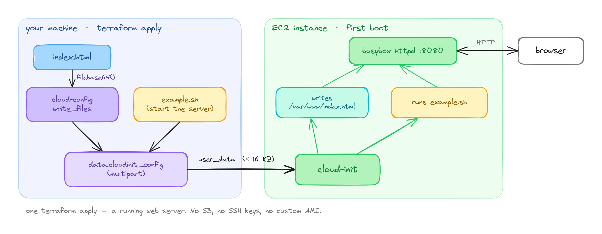

I've been working on a simple demo project that uses Terraform & CircleCI to deploy infrastructure to AWS. The use case is designed to convey the intersection of two important concepts that when combined, represent cutting-edge software delivery practices: Continuous Integration and Infrastructure as Code. When applied correctly together, the continuous deployment of infrastructure is a powerful paradigm shift in the industry that amplifies the power of cloud-native technologies.

The project, aptly called <a href="https://github.com/aedifex/terrasphere">"Terrasphere"</a> (actually terrasphere is a goofy name; suggestions welcome), simply deploys an EC2 instance using Terraform on CircleCI. Of course, deploying an instance by itself isn't terribly exciting. Getting the instance to respond to web requests by running a lightweight server? Now we're talking.

The issue I ran into was pretty simple. I needed to copy a static HTML file from the local filesystem onto the instance and execute a simple 4-line shell script. None of the potential solutions I explored reflected the simplicity of the problem.

A number of solutions came to mind:

1. Use an intermediary storage service, perhaps S3 (potentially requires configuration) to store the HTML file, could also use a Gist. Then copy the script into user_data to pull in the file and start the server.

2. Create a custom AMI with the code already copied over to the image's filesystem (Packer could simplify the process, but still...that's a lot of work for two files).

3. SSH / SCP? Also possible. Now we have to think about ssh key management. Also, if this can be automated...we can presumably get other files into the file system.

4. Docker? Actually...could be a viable solution, but we still need to give our instance user_data (instructions to execute during startup). If we can feed the instance instructions to run a Docker image...we can in theory use the same mechanism to execute our script and copy over our html file.

5. Local file provisioners plus remote connections. Basically, an amalgam of option 3 with a few cool Terraform tools.

- <a href="https://developer.hashicorp.com/terraform/language/resources/provisioners/file">File provisioners</a>
- <a href="https://developer.hashicorp.com/terraform/language/resources/provisioners/connection">Provisioner Connection Settings</a>

Option 5 was beginning to look like the only viable solution until I stumbled across a great post on <a href="https://stackoverflow.com/questions/62101009/terraform-copy-upload-files-to-aws-ec2-instance">Stack Overflow</a>. I cannot take credit for the solution, though I was able to implement it with a few minor modifications.

TL;DR

Use a combination of cloud-init's "write_files" module to place arbitrary files into the file system. The files are base64-encoded and passed directly to the instance via `user_data` at provisioning time. A local file, e.g. our HTML file, can be interpolated in this fashion. Multiple files can be processed as well using this pattern, however EC2 caps `user_data` at 16 KB, so keep the files small. The solution looks as follows:

```
locals {
  cloud_config_config = <<-END
    #cloud-config
    ${jsonencode({
      write_files = [
        {
          path        = "/var/www/index.html"
          permissions = "0644"
          owner       = "root:root"
          encoding    = "b64"
          content     = filebase64("${path.module}/index.html")
        },
      ]
    })}
  END
}

data "cloudinit_config" "example" {
  gzip          = false
  base64_encode = false

  part {
    content_type = "text/cloud-config"
    filename     = "index.html"
    content      = local.cloud_config_config
  }

  part {
    content_type = "text/x-shellscript"
    filename     = "example.sh"
    content  = <<-EOF
      #!/bin/bash
      cd /var/www/
      nohup busybox httpd -f -p 8080 &
    EOF
  }
}
```

Then simply pass this data in as `user_data` like this:

`user_data = data.cloudinit_config.example.rendered`

<figure style="margin:2em 0">
  
  <figcaption style="font-size:0.8em;font-style:italic;color:#777;text-align:left;margin-top:0.5em;padding-left:0.8em;border-left:3px solid #ddd">The whole flow in one picture. Left: your machine, when you run <code>terraform apply</code>. Right: the instance, once, on first boot. The only thing that crosses the line is <code>user_data</code>: no SSH session, no S3 bucket, no custom AMI.</figcaption>
</figure>

Perfect! This is exactly what we were looking for. A very elegant solution to a simple problem.

I'd like to give credit to <a href="https://stackoverflow.com/users/281848/martin-atkins">Martin Atkins</a> for a very concise explanation to a similar issue someone on the interwebz was facing.

Fin