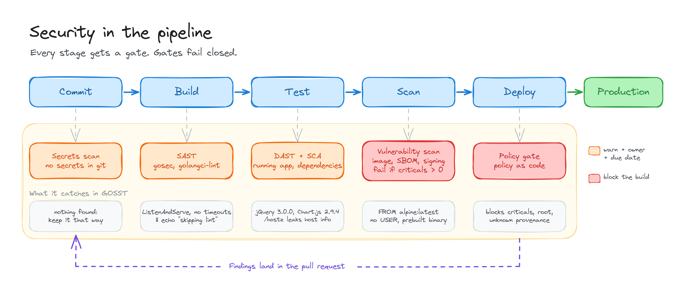

Most security tooling fails not because the scanners are bad, but because nobody acts on the results.

## The patient

[GOSST](https://github.com/aedifex/GOSST) is a small Go service I built to demo CI/CD: standard library only, a Dockerfile, a Makefile. It builds, tests, and ships. It looks clean. Let's point a security pipeline at it.

<figure style="margin:2em 0">
  <a href="/assets/img/devsecops-diagram.png"></a>
  <figcaption style="font-size:0.8em;font-style:italic;color:#777;text-align:left;margin-top:0.5em;padding-left:0.8em;border-left:3px solid #ddd">Every stage gets a gate, and gates fail closed. Orange gates warn with an owner and a due date; red gates stop the pipeline. The bottom row is what each gate finds in GOSST.</figcaption>
</figure>

## What the pipeline finds

- **Floating base image:** `FROM alpine:latest`. The same commit can ship a different OS each build. *Pin by digest; scan the image.*
- **Runs as root:** no `USER` in the Dockerfile. *Container scan / policy check.*
- **No provenance:** the image copies a prebuilt `main_linux`. From the pipeline, or a laptop? *Multi-stage build, SBOM, signed image.*
- **Old vendored libraries:** jQuery 3.0.0 and Chart.js 2.9.4 sit in `static/vendors`. *Dependency scanning (SCA).*
- **Chatty endpoints:** `/hostz` hands anyone the hostname, PID, and runtime details. *Dynamic testing (DAST) against the running app.*
- **No server timeouts:** `http.ListenAndServe`, bare. *Static analysis (gosec).*

And the best one, a gate that fails open:

```make
lint:
	@golangci-lint run --timeout=5m || echo "golangci-lint not found, skipping lint"
```

No linter, no problem: the build goes green anyway. The checks pass, and some of them never ran.

## What should block a build

**Block:** criticals with a fix, secrets, root in prod, unknown provenance. **Warn:** everything else, with an owner and a due date. **Exempt:** only with an expiry date. Write it as policy as code, reviewed like any other change.

## The SRE angle

Every finding you ignore is an incident with a delayed start time. Security in the pipeline is reliability work done early, when it's cheapest.
