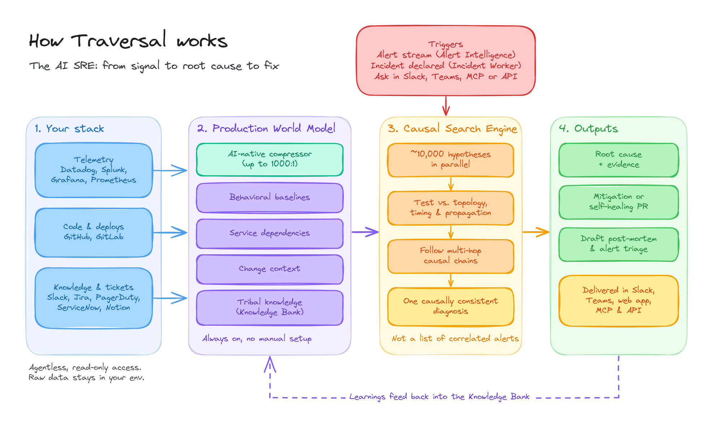

## The story so far

After years of helping teams build, test, secure, and deploy software, I'm moving back to the other end of the lifecycle: production, the engine room. The questions there are simple to ask and hard to answer: what happens when things break, how do we fix them, and how do we stop them from breaking again?

Come, let me tell you a tale.

## The road here

Harness had been an incredible run. Starting my career in CI at CircleCI (my alma mater) and building a deep understanding of DevOps and operations as an SRE was transformative. I spent considerable time, professionally and academically, understanding the journey from code to artifact. Harness was the logical next place to take that skill set: to help make customers successful, and to complete my SDLC journey with a strong, platform-oriented story from artifact to production. I worked with great companies and great people, solved complex problems, secured software delivery, and helped accelerate innovation for leading technology companies.

When I discovered Traversal, I was impressed with the technology; the platform was truly innovative. A friend and former colleague had already taken the plunge as an early SE. I had several interview threads running in parallel, but after meeting more of the Traversal team, including one of the founders, it was evident: I wanted to work for Traversal, be part of something unique, be an effective solutions engineer, and transform incident response for innovative companies. It was the combination of the technology and the people, both exceptional. I'm honored and grateful to be part of the team.

## Why production

Every incident starts the same way: an alert at an inconvenient hour, a wall of dashboards, and an engineer trying to reconstruct what changed across systems no single person fully understands. Modern systems produce more telemetry than any team can read. The bottleneck isn't data; it's investigation. That's the problem Traversal goes after: an AI SRE that triages alerts, traces an incident back to its root cause, and helps teams stop it from happening again.

<figure style="margin:2em 0">
  
  <figcaption style="font-size:0.8em;font-style:italic;color:#777;text-align:left;margin-top:0.5em;padding-left:0.8em;border-left:3px solid #ddd">How Traversal works, left to right: your stack feeds a model of production; a trigger kicks off the search; out comes one diagnosis, not a pile of correlated alerts. Every investigation teaches the model something for next time. Drawn from Traversal's public docs.</figcaption>
</figure>

I've spent my career on the build-and-ship side of that equation: pipelines, artifacts, deployments, guardrails. Production is where all of that work is finally tested, not by a test suite, but by reality. It feels right to close the loop there.

## What's next

I'll be writing here about what I learn along the way: incident response, observability, and what it takes for AI to earn its place in the engine room. *Aedifex* is Latin for builder. It turns out builders have to fix things, too.
